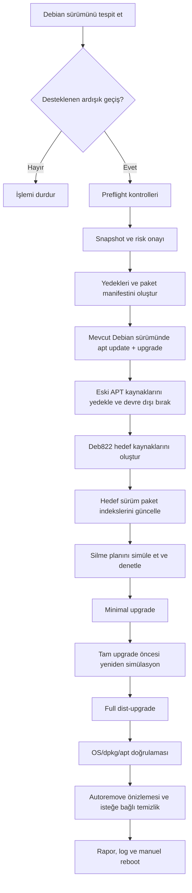

<div align="center">

# 🚀 Debian Upgrade Manager

### Debian sürüm yükseltmeleri için kontrollü, yedeklemeli ve denetlenebilir Bash aracı

**v3.0.0** · **Debian 11 → 12 → 13** · **Bash 5+** · **MIT**

[](https://www.shellcheck.net/)
[](https://www.debian.org/releases/)
[](LICENSE)
[](https://github.com/MRsuffixx/debian-update)

[Özellikler](#-özellikler) · [Kurulum](#-kurulum) · [Komutlar](#-komutlar) · [Güvenlik](#-güvenlik-modeli) · [Sorun Giderme](#-sorun-giderme) · [English](#-english-summary)

</div>

> [!WARNING]
> **Dağıtım yükseltmesi risklidir.** Bir VPS/VDS/sunucuyu yükseltmeden önce sağlayıcınız üzerinden **tam disk/VM snapshot'ı**, tercihen harici bir yedek, doğrulanmış kurtarma konsolu (VNC/KVM/rescue) ve bakım penceresi hazırlayın. Araç hiçbir sistemde kesintisiz veya hatasız yükseltme garantisi vermez. Oluşturduğu `tar.gz` yapılandırma arşivi **işletim sistemini geri alma mekanizması değildir**.

## ✨ Özellikler

| Özellik | Açıklama |
|---|---|
| 🎯 Otomatik Debian tespiti | `/etc/os-release`, sürüm numarası, kod adı, mimari |
| 🛡️ Ön kontroller | Debian kimliği, sıralı sürüm geçişi, root, dpkg, APT süreçleri, disk, DNS, SSH, hold, pinning, container/WSL |
| 📦 Modern depo yönetimi | Debian'ın `deb822` biçimindeki `.sources` dosyalarını üretir; `Signed-By` keyring kullanır |
| 🚫 Üçüncü taraf depo izolasyonu | Eski `.list` / `.sources` girdilerini arşivleyip yükseltme sırasında devre dışı bırakır |
| 💾 Kritik yedekler | `/etc/apt`, SSH, ağ, systemd, fstab, dpkg durumu, paket manifestleri, SHA-256 |
| 🧪 Gerçekçi dry-run | Geçici APT indeksleriyle hedef sürümün depo verilerini indirir ve *simülasyon* yapar |
| 📊 Aşama/ilerleme | Renkli durum etiketleri, bölüm başlıkları ve APT'nin canlı işlem çıktıları |
| 📝 Log ve rapor | `/var/log/debian-upgrade-manager/`, yedek klasörü altında işlem planları |
| 🔄 Kurtarma odaklı durum | Aşamaların diske kaydı, `--resume`, güvenli koşullarda `--restore-sources` |
| ⚡ Otomasyon | `--non-interactive --yes --accept-risk` ile konsol onaysız çalıştırma |
| 🧹 Kontrollü temizlik | `autoremove` simülasyonu, isteğe bağlı gerçek uygulama ve `apt-get clean` |
| 🧯 Paket korumaları | Belirli kritik paketlerin kaldırılmasını engeller, kaldırılacak paketlere sayı sınırı koyar |
| 🔐 Yetki ve erişim | Root sahipliğinde `0600` log/state, `0700` yedek dizinleri, tek-instance kilidi |
| 📴 Yeniden başlatma kontrolü | Asla kendi kendine `reboot` çağırmaz |

## 🧭 Desteklenen Debian sürümleri

| Mevcut sistem | Hedef | Durum |
|---|---|---|
| Debian 11 **Bullseye** | Debian 12 **Bookworm** | ✅ Sıralı geçiş; çalışan güncelleme depoları gerekli |
| Debian 12 **Bookworm** | Debian 13 **Trixie** | ✅ Sıralı geçiş |
| Debian 13 **Trixie** | Debian 14 **Forky** | ⛔ Test sürümüne geçiş kapalı |
| Debian 9/10 | Herhangi bir sürüm | ⛔ Bu sürümde desteklenmiyor |
| Ubuntu, Kali, Linux Mint, Proxmox VE | Herhangi bir sürüm | ⛔ Desteklenmiyor |
| Docker/LXC container, WSL | Herhangi bir sürüm | ⛔ Desteklenmiyor |

**Neden doğrudan 11 → 13 yok?** Debian'ın yayınladığı ve belgelediği ana sürüm yükseltme yöntemi, önce bir sonraki kararlı sürüme geçmektir. Her geçiş ayrı tamamlanmalı, servisler kontrol edilmeli, yeniden başlatılmalı ve tekrar yedek alınmalıdır.

Resmî belgeler: [Debian sürümleri](https://www.debian.org/releases/) · [12 / Bookworm yükseltme notları](https://www.debian.org/releases/bookworm/releasenotes) · [13 / Trixie yükseltme notları](https://www.debian.org/releases/trixie/release-notes/upgrading.en.html).

## 🧩 Sistem gereksinimleri

- Debian 11 veya 12, root/sudo erişimi, `apt-get`, `dpkg`, `dpkg-query`, `apt-mark`, `tar`, `flock`, `sha256sum`, `getent` ve standart GNU araçları.
- Çalışan bir DNS/ağ bağlantısı ve Debian APT depolarına erişim.
- **En az yaklaşık 2 GiB `/`, 3 GiB `/var`** boş alan (aynı dosya sistemiyse bu değerler bağımsız boş alan bütçeleri değildir). Ayrı bağlı `/boot` için **256 MiB**. Bunlar yalnızca *başlangıç eşikleri*; gerçek ihtiyaç daha fazla olabilir.
- Özellikle VDS/VPS ortamlarında sağlayıcı **snapshot + kurtarma konsolu**, yeterli bakım süresi, kritik uygulamaların harici yedekleri.
- SSH oturumunda `tmux` veya `screen` kullanılması önerilir; SSH'dan çalıştırmak ayrıca `--allow-ssh` gerektirir.
- APT/dpkg kilidi kullanan başka işlem bulunmamalı; `dpkg --audit` temiz olmalı. Pinning ve hold olan sistemler varsayılan olarak durdurulur.

> [!IMPORTANT]
> Docker, Coolify, Pterodactyl, PostgreSQL, MySQL/MariaDB, Mailcow, özel kernel, cloud-init, NVIDIA sürücüsü veya özel depo kullanan makinelerde ilgili ürünlerin Debian 13 uyumluluk notlarını **ayrıca okuyun**. Bu araç uygulama/veritabanı yedeği almaz, üçüncü taraf depolarını kendiliğinden yeniden etkinleştirmez.

## 📥 Kurulum

### 1. Git (önerilen)

```bash
git clone https://github.com/MRsuffixx/debian-update.git
cd debian-update
chmod +x debian-upgrade.sh
./debian-upgrade.sh --help
sudo ./debian-upgrade.sh --check
```

### 2. curl ile indirme

```bash
curl --fail --location --show-error --output debian-upgrade.sh \
  https://raw.githubusercontent.com/MRsuffixx/debian-update/main/debian-upgrade.sh

# İndirilen kodu çalıştırmadan önce inceleyin.
less debian-upgrade.sh
bash -n debian-upgrade.sh
chmod +x debian-upgrade.sh
sudo ./debian-upgrade.sh --check
```

### 3. wget ile indirme

```bash
wget -O debian-upgrade.sh \
  https://raw.githubusercontent.com/MRsuffixx/debian-update/main/debian-upgrade.sh

less debian-upgrade.sh
bash -n debian-upgrade.sh
chmod +x debian-upgrade.sh
sudo ./debian-upgrade.sh --check
```

> **Önemli:** Bu komutlar, güncellenmiş `debian-upgrade.sh` dosyası `main` dalına **yüklendikten sonra** yeni sürümü indirecektir. Kod güvenliği açısından doğrudan `curl | sudo bash` ya da `wget -O- | bash` önerilmez. Mümkünse belirli bir sürüm etiketi/commit'e sabitleyin ve checksum doğrulayın. Rastgele indirilen script'i root olarak çalıştırmayın.

## 🎮 İnteraktif kullanım

```bash
sudo ./debian-upgrade.sh
```

```text
════════════════════════════════════════════════════════════
  Debian Upgrade Manager 3.0.0
════════════════════════════════════════════════════════════
  1) Preflight checks / Sistem kontrolü
  2) Dry-run / Simülasyon
  3) Upgrade / Sürüm yükselt
  4) Backup only / Sadece yedek
  5) Status / Durum
  6) Resume / Devam et
  7) Restore sources / APT depolarını geri yükle
  8) Cleanup / Temizlik
  0) Exit / Çıkış
  Seçiminiz:
```

`3` seçilirse hedef sürüm belirlenir, kontroller yürütülür ve kullanıcıdan **`YUKSELT`** yazması istenir. Bu onay; mevcut disk snapshot'ını, geri dönüş ve konsol erişimini doğrulama sorumluluğunu kullanıcıya bırakır.

## 💻 Komutlar

| Komut | İşlem | Sistem paketlerini değiştirir mi? |
|---|---|---|
| `sudo ./debian-upgrade.sh --check` | Ön kontroller | Hayır |
| `sudo ./debian-upgrade.sh --dry-run` | İzole APT indeksleri + yükseltme simülasyonu | Hayır; ağ ve geçici disk kullanır |
| `sudo ./debian-upgrade.sh --backup-only` | Kritik yapılandırma yedekleri | Paketleri değiştirmez |
| `sudo ./debian-upgrade.sh --upgrade` | Gerçek sürüm yükseltmesi | **Evet** |
| `sudo ./debian-upgrade.sh --resume` | Yarım kalan yükseltmeyi sürdürür | **Evet** |
| `sudo ./debian-upgrade.sh --restore-sources` | Paket yükseltmesi başlamadan önce eski APT dosyalarını geri getirir | Depo ayarlarını değiştirir |
| `sudo ./debian-upgrade.sh --cleanup` | Önizleme + onayla `autoremove`/`clean` | **Evet** |
| `sudo ./debian-upgrade.sh --status` | İşlem durumu | Hayır |
| `./debian-upgrade.sh --version` | Sürüm bilgisi | Hayır |

### Hedef sürüm ve depo bileşenleri

```bash
# Debian 12 üzerinde yalnızca 13/Trixie geçerlidir.
sudo ./debian-upgrade.sh --upgrade --target trixie

# Gerekirse açık bileşen listesi:
sudo ./debian-upgrade.sh --upgrade \
  --components main,contrib,non-free,non-free-firmware
```

Aracın varsayılan bileşenleri `main non-free-firmware`; mevcut etkin kaynaklarda `contrib` / `non-free` varsa onları da korumaya çalışır. Değişiklik öncesi yapılandırmayı mutlaka inceleyin.

### SSH / VDS senaryosu

```bash
# Sunucuda tmux kullanın; out-of-band rescue konsolunu da hazır tutun.
tmux new -s debian-upgrade

sudo ./debian-upgrade.sh --check --allow-ssh
sudo ./debian-upgrade.sh --dry-run --allow-ssh
sudo ./debian-upgrade.sh --upgrade --allow-ssh

# SSH düşerse, yeniden bağlanıp:
tmux attach -t debian-upgrade
```

`--allow-ssh` SSH bağlantısının kopmasını **engellemez**, yalnızca bu riskin bilindiğini belirtir.

### ⚡ Etkileşimsiz yükseltme

```bash
sudo ./debian-upgrade.sh \
  --upgrade \
  --non-interactive \
  --yes \
  --accept-risk \
  --allow-ssh \
  --auto-clean
```

Bu örnek **paket silme planı yoksa** kendiliğinden devam eder. APT kaldırılacak paket önerirse `--allow-removals` gerektirir (varsayılan üst sınır **10**); kritik paket silinmesi her durumda engellenir.

```bash
# Yalnızca bağımlılık ve silme planını önceden incelediyseniz:
sudo ./debian-upgrade.sh \
  --upgrade --non-interactive --yes --accept-risk \
  --allow-ssh --allow-removals --max-removals 5 --auto-clean
```

`--allow-holds` veya `--allow-pinning` ancak riskleri değerlendirildikten sonra kullanılmalı. Etkileşimsiz APT yapılandırmasında mevcut dosyaları korumaya öncelik verilir (`--force-confdef` / `--force-confold`); yine de her paket betiğinin hiçbir zaman kullanıcı girişi istemeyeceği **garanti değildir**. Servislerin davranışı da değişebilir. Mümkünse kritik sistemleri gözetimsiz yükseltmeyin.

## 🧱 Yükseltme akışı



### Kayıtlı aşamalar

`preparing` → `base-updated` → `sources-switched` → `target-index-updated` → `minimal-started` → `minimal-done` → `full-started` → `full-done` → `complete`.

Kritik işlemlerden sonra durum atomik olarak diske yazılır. Beklenmeyen kesintiden sonra mümkünse ilk olarak `sudo ./debian-upgrade.sh --status`, sonra `--resume` kullanın. **Paket veritabanı bozuksa devam etmeden önce uzman müdahalesi gerekir.** Betik evrensel olarak hatasız devam/rollback garantisi vermez.

## 🛡️ Güvenlik modeli

**Koruyucu varsayılanlar:**

1. Yalnızca Debian 11 → 12 ve 12 → 13; `testing`, `unstable`, sürüm atlama ve Debian türevleri reddedilir.
2. `/etc/apt/sources.list` ve `/etc/apt/sources.list.d/` önce yedeklenir; üçüncü taraf kaynaklar yükseltme sırasında kapatılır.
3. Paket kaldırma önerisi simüle edilir ve kritik paket silme talepleri durdurulur; izin verilmemiş yüksek sayıda silme engellenir.
4. Paket yönetim kilitleri için hem araç kilidi hem de çalışan APT/dpkg işlemlerine karşı kontrol bulunur. Bu kontrol tam bir dağıtık kilitleme mekanizması değildir.
5. Dosyalar hassas olabileceğinden log ve yedek dizin izinleri kısıtlanır.
6. Debian paket imza doğrulaması etkin kalır; `[trusted=yes]`, `--allow-unauthenticated` gibi tehlikeli seçenekler kullanılmaz.
7. Önceden alınan snapshot'ı varsayar; **otomatik rollback ve otomatik reboot yoktur**.

> [!CAUTION]
> `--accept-risk`, fiziksel/donanımsal veya sanallaştırma yedeği **oluşturmaz**. Yalnızca gerekli tedbirleri aldığınızı beyan eder. Çalışan servislerin durması, özel çekirdek/bootloader sorunları, platforma özgü kurulumlar ve paket betiklerinin etkileşim gerektirmesi yazılımla tamamen önlenemez.

## 💾 Yedekler, loglar, gizlilik

```text
/var/backups/debian-upgrade-manager/
└── 20261018T180000Z-1234/
    ├── original-sources/
    │   ├── sources.list
    │   └── sources.list.d/
    ├── disabled-sources/
    ├── system-config.tar.gz
    ├── dpkg-selections.txt
    ├── packages.tsv
    ├── apt-manual.txt
    ├── apt-auto.txt
    ├── apt-holds.txt
    ├── system-info.txt
    ├── pre-minimal-plan.txt
    ├── full-upgrade-plan.txt
    ├── autoremove-plan.txt
    ├── SHA256SUMS
    └── upgrade-report.txt

/var/lib/debian-upgrade-manager/current.state
/var/log/debian-upgrade-manager/YYYYMMDD-HHMMSS-PID.log
```

Arşivde SSH yapılandırmaları/anahtarları veya paket depo kimlik bilgileri bulunabilir. **GitHub'a, Discord'a veya herkese açık hata raporlarına bu arşivleri yüklemeyin.** Başarılı işlem sonrası `SHA256SUMS` ile arşiv bütünlüğünü kontrol edin:

```bash
cd /var/backups/debian-upgrade-manager/YEDEK_KLASORU
sudo sha256sum -c SHA256SUMS
```

`tar.gz`, yalnızca seçili yapılandırma ve paket kayıtlarını içerir. Veritabanı dosyaları, kullanıcı dosyaları, uygulama durumları, disk bölümleme ve boot yapısı için ayrı yedek/snapshot şarttır.

## 🧯 Sorun giderme

### `dpkg was interrupted`, `dpkg --audit` başarısız

```bash
sudo dpkg --audit
sudo dpkg --configure -a
sudo apt-get -f install
sudo ./debian-upgrade.sh --status
```

Yukarıdaki komutlar **paketleri değiştirebilir**. Bunları ancak konsol üzerinden durum incelemesi ve gereken müdahaleler sonrası çalıştırın. Ardından durum uygunsa:

```bash
sudo ./debian-upgrade.sh --resume --allow-ssh
```

### Hedef APT kaynaklarına erişim yoksa

Kritik: Paket yükseltmesine **henüz başlanmadıysa**, aşağıdaki komut eski APT kaynaklarını geri yükleyebilir:

```bash
sudo ./debian-upgrade.sh --status
sudo ./debian-upgrade.sh --restore-sources
sudo apt-get update
```

`--restore-sources`, `minimal-started` ve sonrasında **bilinçli olarak kapatılmıştır**. Paketleri daha yeni Debian sürümüne taşıdıktan sonra eski sürümün depolarını tek başına geri getirmek sistemi bozabilir; bu durumda sağlayıcı snapshot'ından geri dönün veya Debian kurtarma belgelerini izleyin.

### Üçüncü taraf programlar güncellenmiyor

Bu beklenen davranıştır. Debian yükseltmesi bittikten sonra Docker/PostgreSQL/panel/ajan gibi yazılımların **yeni sürüme uygun** resmî depo yönergelerini uygulayın. `disabled-sources/` içerisindeki eski dosyaları otomatik kopyalamayın; yeni dağıtımın kod adı, anahtarı, imza ve sürüm uygunluğu ayrı ayrı doğrulanmalıdır.

### Paketler kaldırılmak isteniyor

```bash
sudo ./debian-upgrade.sh --dry-run --allow-ssh
sudo ./debian-upgrade.sh --status
sudo ls -la /var/backups/debian-upgrade-manager/
```

Ayrıntılı kaldırma planları ilgili yedek klasöründeki `pre-minimal-plan.txt` ve `full-upgrade-plan.txt` dosyalarına yazılır. Tehlikeli kaldırmaları **`--max-removals` değerini yükselterek geçiştirmeyin**; önce paketlerin neden kaldırıldığını anlayın.

### İşlem sonunda kontrol

```bash
cat /etc/os-release
sudo dpkg --audit
sudo apt-get check
systemctl --failed
uname -r
sudo reboot  # YALNIZCA servis/konsol kontrolünden sonra
```

Çekirdeğin yeni sürümünü görebilmek için genellikle yeniden başlatma gerekir. Bu araç reboot yapmaz.

## 🧪 Geliştirme ve kalite

```bash
bash -n debian-upgrade.sh
shellcheck -S warning debian-upgrade.sh
bash tests/test-cli.sh
```

CI taslağı: `.github/workflows/ci.yml`. İkinci aşama için Debian 11/12 VM snapshot'ları üzerinde uçtan uca test yapılması önerilir. Yalnızca statik testler **başarılı bir gerçek OS yükseltmesini kanıtlamaz**.

### Katkı

Hata raporlarında işletim sistemi sürümünü, komutu, hangi aşamada kalındığını ve hassas bilgi içermeyen anonimleştirilmiş log kesitlerini paylaşın. PR'larda ShellCheck ve CLI testleri çalıştırın. Özellikle farklı mimariler ve sağlayıcı ağ/boot yapılandırmalarındaki sonuçlar değerlidir.

## 🌍 English summary

**Debian Upgrade Manager** is a defensive Bash release-upgrade workflow for the explicitly supported transitions **Debian 11 → 12** and **Debian 12 → 13**. It offers preflight checks, isolated `--dry-run`, deb822 repository management, private configuration backups, resumable checkpoints, package-removal guards, interactive/noninteractive operation, verbose logs, and opt-in cleanup.

It does **not** promise zero downtime, unattended safety, universal hardware compatibility, full OS backup, automated rollback, or automatic reboot. **Take a verified snapshot and read official Debian release notes before using it on any production machine.** Third-party repositories are disabled during the transition and require manual compatibility review afterward.

Example:

```bash
sudo ./debian-upgrade.sh --check
sudo ./debian-upgrade.sh --dry-run
sudo ./debian-upgrade.sh --upgrade
```

## 📄 Lisans

[MIT License](LICENSE) · Proje sahibi: **MRsuffixx** · [GitHub deposu](https://github.com/MRsuffixx/debian-update)

---

<div align="center">

**Yükseltmeden önce snapshot al. Planı incele. Kontrollü ilerle.**

</div>
